# FinTech Payment Clearing Architecture Specification

This document details the architectural boundaries, network segmentation, zero-trust controls, and mathematical graph modeling for the FinTech Payment Clearing & Settlement Core.

---

## 1. Multi-Tier Zero-Trust Network Topology

The architecture divides infrastructure into three isolated subnet tiers across dual AWS Availability Zones (`us-east-1a` and `us-east-1b`):

### 1.1 Ingress DMZ Tier (Public)
* **Subnets:** `aws_subnet.public_a` (`10.50.1.0/24`), `aws_subnet.public_b` (`10.50.2.0/24`).
* **Ingress Security:** Governed by `aws_security_group.pci_ingress_sg`.
* **Routing:** Bound to `aws_route_table.public_rt` with direct routing through `aws_internet_gateway.fintech_igw`.
* **Function:** Terminates TLS traffic for payment API requests from payment rails (Visa, Mastercard, SWIFT, SEPA).

### 1.2 Application Processing Tier (Private)
* **Subnets:** `aws_subnet.app_a` (`10.50.10.0/24`), `aws_subnet.app_b` (`10.50.20.0/24`).
* **Ingress Security:** Governed by `aws_security_group.app_tier_sg`, strictly accepting connections only from `pci_ingress_sg` on TCP port 8443.
* **Compute:** `aws_instance.payment_worker_a` hosting high-frequency settlement microservices.
* **Function:** Transaction parsing, tokenization, fraud checks, and clearing ledger operations.

### 1.3 Cardholder Data Environment (CDE) Database Tier (Private Isolated)
* **Subnets:** `aws_subnet.db_a` (`10.50.30.0/24`), `aws_subnet.db_b` (`10.50.40.0/24`).
* **Subnet Group:** `aws_db_subnet_group.fintech_db_subnets`.
* **Ingress Security:** Governed by `aws_security_group.db_tier_sg`, strictly accepting TCP port 5432 ingress solely from `app_tier_sg`.
* **Storage:** Multi-AZ PostgreSQL `aws_db_instance.settlement_db`.
* **Zero Direct Egress:** No Internet Gateway or NAT Gateway route association.

---

## 2. Cryptographic Architecture

* **Master Key:** `aws_kms_key.fintech_ledger_cmk` configured with automated 365-day rotation.
* **Key Alias:** `aws_kms_alias.fintech_ledger_key_alias` (`alias/fintech-payment-ledger`).
* **Envelope Encryption:** Used for encrypting tokenized Primary Account Numbers (PAN) before storage in `aws_s3_bucket.cardholder_data_archive`.
* **Audit Trail Integrity:** Encrypts multi-region event trails generated by `aws_cloudtrail.fintech_audit_trail`.

---

## 3. Dependency Directed Acyclic Graph (DAG)

```mermaid
graph TD
    VPC["aws_vpc.fintech_vpc (CRITICAL_ROOT)"]
    IGW["aws_internet_gateway.fintech_igw"]
    PublicSubA["aws_subnet.public_a"]
    PublicSubB["aws_subnet.public_b"]
    AppSubA["aws_subnet.app_a"]
    AppSubB["aws_subnet.app_b"]
    DBSubA["aws_subnet.db_a"]
    DBSubB["aws_subnet.db_b"]
    
    PublicRT["aws_route_table.public_rt"]
    PublicAssocA["aws_route_table_association.public_a_assoc"]
    PublicAssocB["aws_route_table_association.public_b_assoc"]
    
    IngressSG["aws_security_group.pci_ingress_sg"]
    AppSG["aws_security_group.app_tier_sg"]
    DBSG["aws_security_group.db_tier_sg"]
    
    DBSubnetGroup["aws_db_subnet_group.fintech_db_subnets"]
    SettlementDB["aws_db_instance.settlement_db"]
    
    KMSKey["aws_kms_key.fintech_ledger_cmk"]
    KMSAlias["aws_kms_alias.fintech_ledger_key_alias"]
    
    CardholderS3["aws_s3_bucket.cardholder_data_archive"]
    AuditS3["aws_s3_bucket.settlement_audit_logs"]
    CloudTrail["aws_cloudtrail.fintech_audit_trail"]
    
    IAMRole["aws_iam_role.payment_worker_role"]
    IAMPolicy["aws_iam_policy.payment_worker_policy"]
    IAMAttach["aws_iam_role_policy_attachment.payment_worker_attach"]
    IAMProfile["aws_iam_instance_profile.payment_worker_profile"]
    WorkerA["aws_instance.payment_worker_a"]
    
    VPC --> IGW
    VPC --> PublicSubA
    VPC --> PublicSubB
    VPC --> AppSubA
    VPC --> AppSubB
    VPC --> DBSubA
    VPC --> DBSubB
    VPC --> PublicRT
    VPC --> IngressSG
    VPC --> AppSG
    VPC --> DBSG
    
    IGW --> PublicRT
    PublicRT --> PublicAssocA
    PublicRT --> PublicAssocB
    PublicSubA --> PublicAssocA
    PublicSubB --> PublicAssocB
    
    IngressSG --> AppSG
    AppSG --> DBSG
    
    DBSubA --> DBSubnetGroup
    DBSubB --> DBSubnetGroup
    DBSubnetGroup --> SettlementDB
    DBSG --> SettlementDB
    
    KMSKey --> KMSAlias
    
    AuditS3 --> CloudTrail
    
    IAMPolicy --> IAMAttach
    IAMRole --> IAMAttach
    IAMRole --> IAMProfile
    
    AppSubA --> WorkerA
    AppSG --> WorkerA
    IAMProfile --> WorkerA
```

---

## 4. Blast-Radius Centrality Formulation

RegRadar bounds operational risk using NetworkX directed centrality:

$$S(v) = 0.45 \cdot R_{\text{desc}}(v) + 0.25 \cdot C_B(v) + 0.20 \cdot C_E(v) + 0.10 \cdot C_{\text{out}}(v)$$

Where:
* $R_{\text{desc}}(v)$: Ratio of total resources depending directly or transitively on $v$.
* $C_B(v)$: Betweenness centrality of $v$ along all shortest paths.
* $C_E(v)$: Eigenvector centrality (influence of connected high-degree neighbors).
* $C_{\text{out}}(v)$: Normalized immediate out-degree.

For `aws_vpc.fintech_vpc`:
* Downstream cascading descendants: **16 nodes** (out of 26 total).
* Calculated risk score: **0.3220** $\ge 0.30$ critical threshold.
* Result: Gated as **`CRITICAL_ROOT`**. Automated modifications require signed cryptographic operator sign-off.
